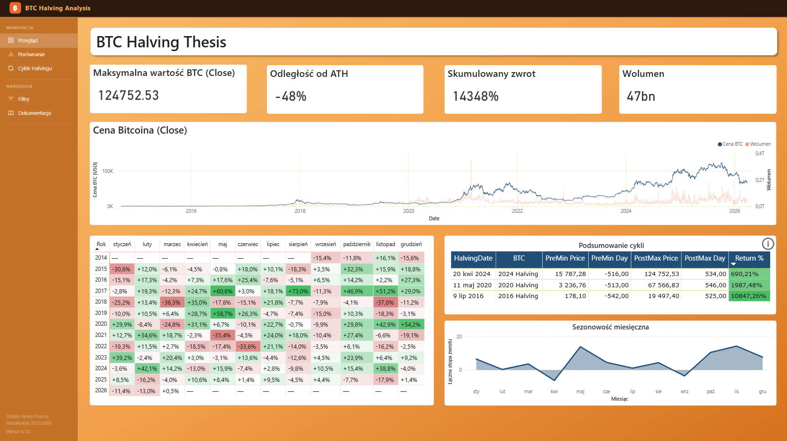
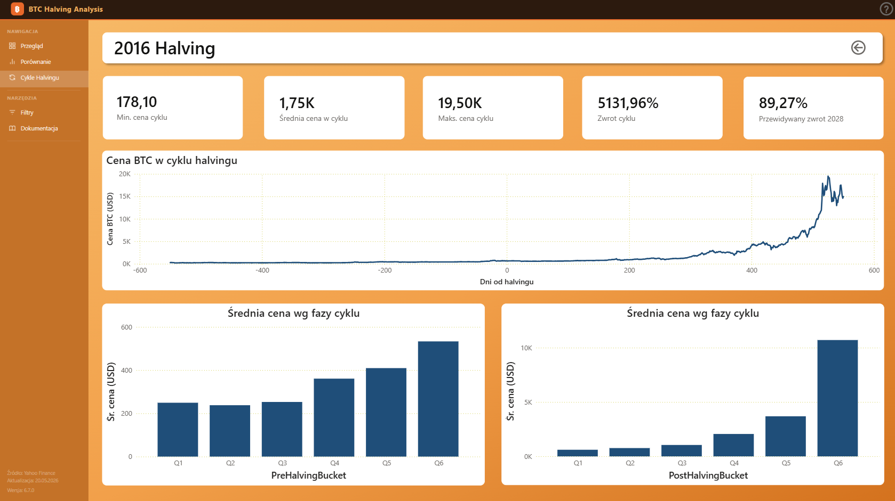
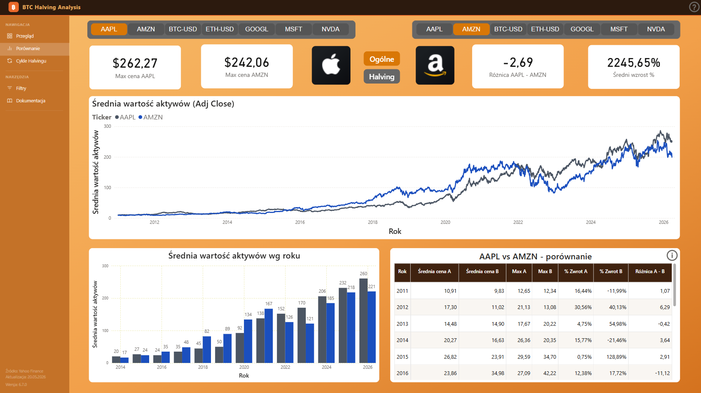
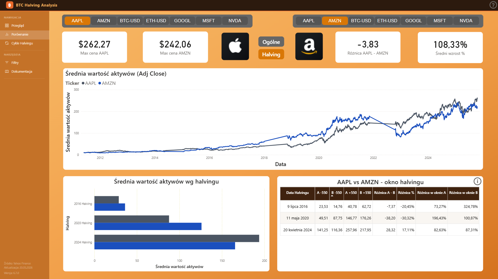
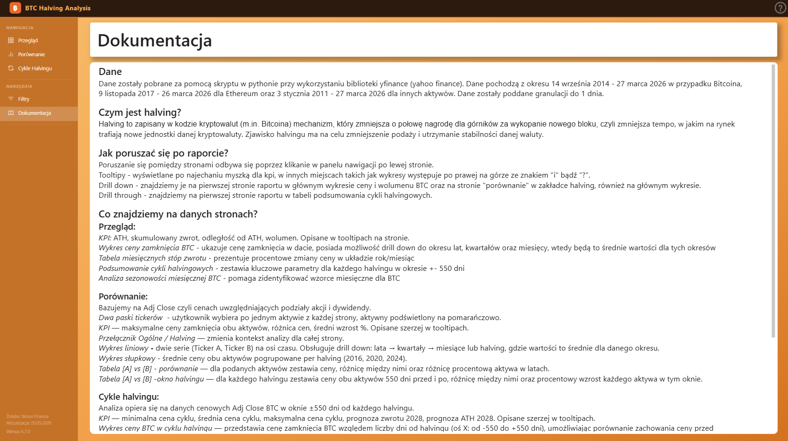
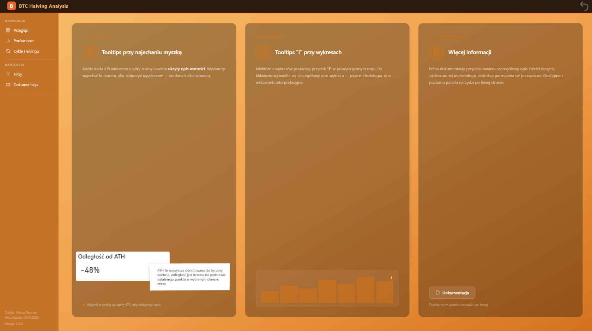
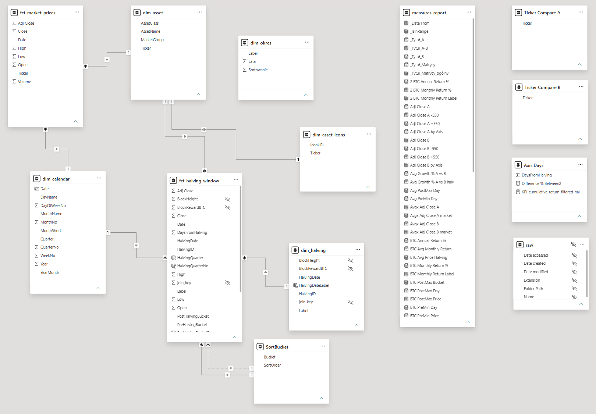

# bitcoin-halving-market-impact

Event-based analysis of BTC, ETH and selected US large-cap stocks around Bitcoin halving dates using Python, Power Query and Power BI.

## Project status

The Power BI report is **complete (final version)**.

The final dashboard is a multi-page, interactive Power BI report with page navigation, custom tooltips and custom visuals. It covers the full intended scope: a BTC-focused overview, per-cycle halving analysis, and cross-asset comparison across BTC, ETH and selected US large-cap stocks.

This remains a **portfolio project** focused on descriptive analysis — see the Limitations section below.

## Project goal

The goal of this project is to analyze how selected market assets behaved in time windows around Bitcoin halving events.

The project is focused on **descriptive analysis**, not causal claims.
It shows how prices, local lows, post-halving highs and selected event-window metrics behaved around known Bitcoin halving dates.

## Scope

- Bitcoin (`BTC-USD`)
- Ethereum (`ETH-USD`)
- selected US large-cap stocks (AAPL, AMZN, GOOGL, MSFT, NVDA)
- event windows aligned to Bitcoin halving dates

## Data coverage

Daily data downloaded with `yfinance` (`src/download_market_data.py`). **The data in this repository and in the Power BI report ends on 2026-03-27** (the report footer shows the date of the last report refresh).

| Asset | First date | Last date |
|---|---|---|
| BTC-USD | 2014-09-17 | 2026-03-27 |
| ETH-USD | 2017-11-09 | 2026-03-27 |
| AAPL, AMZN, GOOGL, MSFT, NVDA | 2011-01-03 | 2026-03-27 |

Because BTC data starts in September 2014, the **2012 halving is not covered**; the analysed cycles are 2016, 2020 and 2024. The 2024 window (±550 days) ends on 2025-10-22, so it is fully covered.

## Dashboard (final version)

The report is organized into navigable pages (with action-button navigation between them):

### 1. Przegląd (Overview)
BTC-focused overview answering: **how did Bitcoin behave around halving windows across historical cycles?**
- KPI / card visuals for key event-window metrics (pre-halving minimum day, post-halving maximum day, number of analyzed cycles),
- a line chart of BTC price paths around halving dates,
- an area chart, a summary table and a detail (pivot) table,
- cycle and days-from-halving slicers.

### 2. Cykle Halvingu (Halving Cycles)
Per-cycle breakdown of halving windows:
- card visuals for cycle-level metrics,
- column and line charts comparing behavior across cycles,
- slicers for cycle selection.

### 3. Porównanie (Comparison)
Cross-asset comparison across BTC, ETH and selected US equities:
- line chart and clustered column chart comparing assets,
- card visuals and a detail table,
- Chiclet Slicer (custom visual) for asset selection.

### 4. Porównanie halving (Halving Comparison)
Comparison focused on halving windows across assets:
- line chart and clustered bar chart,
- card visuals and two detail (pivot) tables,
- Chiclet Slicer for selection.

### 5. Dokumentacja (Documentation) & 6. Pomoc (Help)
In-report documentation and help pages describing the model, metrics and how to navigate the report.

The report also uses **custom tooltips** (dedicated tooltip pages) for richer hover detail, and custom visuals (Chiclet Slicer, Advance Card, Inforiver Filter).

## Data model

The report is built on a star-schema analytical model:
- fact tables for market prices and halving-window observations,
- dimension tables for assets, calendar dates and halving metadata,
- DAX measures for event-window metrics (local lows, post-halving highs, returns, averages).

## Tech stack

- Python
- Pandas
- yfinance
- Power Query
- Power BI (DAX, star-schema modeling, custom visuals)
- Git / GitHub

## How to run

1. Create a virtual environment and install the dependencies:
   ```bash
   python -m venv .venv
   source .venv/bin/activate        # Windows: .venv\Scripts\activate
   pip install -r requirements.txt
   ```
2. (Optional) refresh the raw data. This overwrites the CSV files in `data/raw/` with data up to today:
   ```bash
   python src/download_market_data.py
   ```
3. Reproduce the halving-cycle summary table from the raw data:
   ```bash
   python src/halving_summary.py              # default window: +-550 days
   ```
4. Open `powerbi/bitcoin_halving_market_impact.pbix` in **Power BI Desktop** (Windows). The report is built on the CSV files from `data/`; after refreshing the data, use *Refresh* in Power BI. If the data source path points to a different folder on your machine, update it in *Transform data -> Data source settings*.

## Analysis approach

1. Download daily market data for crypto and selected equities (yfinance).
2. Prepare reference data for Bitcoin halving dates and asset metadata.
3. Align observations into event windows around halving dates.
4. Transform and model data (Power Query + star schema) for reporting.
5. Build interactive Power BI pages for exploratory and descriptive analysis.

## Methodology

- **Event window:** +-550 calendar days around each halving date (`DaysFromHalving` from -550 to +550).
- **PreMin / PostMax:** the lowest BTC close in the 550 days before the halving and the highest BTC close in the 550 days after it.
- **Return % (min -> max):** `PostMax / PreMin - 1`. This is a *best-case, hindsight* measure (buy at the lowest point, sell at the highest), not a tradable return.
- **Other metrics:** price change from the halving-day close to +180 / +365 / +550 days (`src/halving_summary.py`).
- **Prices:** `Adj Close` (adjusted for splits and dividends) for equities; for BTC and ETH `Adj Close` equals `Close`.

## Key findings

Computed from `data/raw/BTC-USD.csv` with `python src/halving_summary.py` (identical to the "Podsumowanie cykli" table in the report):

| Halving | Pre-halving min (day) | Post-halving max (day) | Min -> max return | Change +365 d | Change +550 d |
|---|---|---|---|---|---|
| 2016-07-09 | $178.10 (-542) | $19,497.40 (+525) | +10,847% | +286.9% | +2,200.2% |
| 2020-05-11 | $3,236.76 (-513) | $67,566.83 (+546) | +1,987% | +559.2% | +645.8% |
| 2024-04-20 | $15,787.28 (-516) | $124,752.53 (+534) | +690% | +31.0% | +65.7% |

- **Diminishing returns across cycles:** the min -> max return fell from about 10,800% (2016) to about 2,000% (2020) and about 690% (2024). The change one year after the halving was +287% (2016), +559% (2020) and +31% (2024), so 2020 was the strongest first year and 2024 by far the weakest.
- **Timing:** in all three cycles the post-halving high occurred roughly 525-546 days after the halving, i.e. close to the end of the +550-day window. A longer window could move the maximum, so the "peak day" is partly a property of the window length.
- **Pre-halving lows sit near the start of the window** (-542, -513, -516 days), so the min -> max return depends strongly on where the window starts.
- With only three comparable cycles, none of this is statistical evidence. It describes what happened, not what will happen.

## Limitations

- It does **not** attempt to prove that halving events directly caused price movements.
- The number of historical halving cycles is small.
- Cross-asset comparisons around halving dates should be treated as descriptive context, not hard evidence of market dependency.
- The report includes a "projected 2028 return" KPI (Halving Cycles page). With only three past cycles it is an illustrative extrapolation, not a forecast.
- The data ends on 2026-03-27 (see *Data coverage*); KPIs such as "distance from ATH" refer to that date.

## Screenshots

Screenshots of the final 6-page Power BI report, captured with the default filter state.

### 1. Przegląd (Overview)



BTC close price and volume over time, KPI cards (max close, distance from ATH, cumulative return, volume), a month-by-year returns matrix, the halving cycle summary table and monthly seasonality.

### 2. Cykle Halvingu (Halving Cycles)



Single-cycle view (2016 halving shown): KPI cards with min / average / max price, cycle return and projected 2028 return, the BTC price path in the ±550-day window around the halving, and average price by pre- and post-halving phase.

### 3. Porównanie (Comparison)



General comparison of two selected assets (AAPL vs AMZN shown), with a Chiclet Slicer for each side: max prices, price difference and average growth, average adjusted close over time, yearly averages and a yearly comparison table.

### 4. Porównanie halving (Halving Comparison)



The same comparison switched to the "Halving" context: average asset value per halving (2016, 2020, 2024) and a table with prices 550 days before and after each halving, the difference between the two assets and the change within the window.

### 5. Dokumentacja (Documentation)



In-report documentation: data source (yfinance), what a halving is, how to navigate the report and what each page contains.

### 6. Pomoc (Help)



Help page explaining the KPI hover tooltips, the "i" chart tooltips and where to find the full documentation.

### Data model



Star-schema model: fact tables (`fct_market_prices`, `fct_halving_window`), dimensions (`dim_asset`, `dim_calendar`, `dim_halving`, `dim_okres`, `dim_asset_icons`), a dedicated measures table (`measures_report`) and helper tables used by the comparison pages and sorting (`Ticker Compare A/B`, `Axis Days`, `SortBucket`).

## Why this project

I built this project as a portfolio piece to demonstrate practical skills in:
- event-based analysis,
- financial data preparation,
- dimensional (star-schema) modeling for reporting,
- multi-page Power BI dashboard design with navigation, custom tooltips and custom visuals,
- combining Python, Power Query and BI reporting in one workflow.
